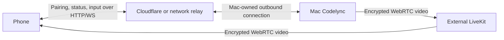

# Codelync Relay and remote desktop deployment

[中文](SELF-HOSTING.zh-CN.md) · [Compose templates](../deploy/self-host/) · [Network relay](../deploy/network-relay/)

This guide describes the current source implementation. The source repository
is public at https://github.com/mapix/Codelync; read or clone it directly.

## Choose what you need

**The Mac already includes LiveKit. In This Mac mode, Codelync starts its owned
local media server on demand and captures the screen only for an explicit phone
connection. An external LiveKit server is optional.**

| Situation | Deploy | Mac configuration |
| --- | --- | --- |
| Phone and Mac have reachable LAN media paths | No additional media server | Media relay → This Mac |
| You want a fixed self-owned communication address | Codelync Network Relay | Connections → Configure Relay |
| Phone is outside the LAN and Mac media ports are unreachable | External LiveKit; retain Cloudflare or another communication channel | Media relay → Custom server |
| Both communication and video should use self-hosted public services | Network Relay and external LiveKit | Configure both forms |

Communication and video require separate working paths. The current network
relay forwards HTTP/WebSocket; WebRTC video uses separate TCP/UDP connections.
The embedded LiveKit server uses dynamic media ports and local network ICE
candidates. The product has no fixed public media-port or external TURN setting
for that server. **Deploying the current network relay alone does not forward
the embedded server's video to a public phone. Cloudflare Quick Tunnel also
carries only the HTTP/WebSocket path here.**

When the Mac's media paths are unreachable, the supported configuration option
is an external LiveKit server. Selecting Custom server makes the Mac use that
server instead of starting its embedded LiveKit. Extending embedded mode to this
public-network scenario would require media ingress, ICE/TURN configuration and
acceptance work; editing Codelync's generated temporary server files is not a
deployment method.



The Mac creates rooms and short-lived tokens. Its video encryption key reaches
the phone through the paired sealed channel, never through the media server.
The phone does not configure API secrets. Keep Codelync running on an unlocked
Mac with Screen Recording permission; input also requires Accessibility.

## Requirements and ports

- Linux VPS with public IPv4, Docker Engine, Docker Compose and Node 24. The
  development baseline is Node 24.15.0; compatible Node 24 security patches are
  supported. Deployment scripts do not need the workspace's pnpm installation.
- Separate real DNS names for the services you select, for example
  `relay.example.com`, `media.example.com` and optional `turn.example.com`.
  Replace these reserved examples before deploying.
- A records pointing directly to the VPS. With Cloudflare DNS, use DNS only;
  ordinary orange-cloud HTTP proxying cannot carry these media ports. Remove
  AAAA records pointing to unreachable IPv6 addresses.
- This template uses Linux host networking. Integrate with an existing TLS proxy
  if it already occupies 80/443. Do not start two listeners on those ports.
- One network-relay instance. Single-node LiveKit needs no Redis. A multi-node
  media cluster is a separate deployment design.

Open the following in both the cloud security group and the host firewall:

| Port | Service | Purpose |
| --- | --- | --- |
| TCP 80, 443 | All profiles | Certificate issuance and HTTPS/WSS |
| TCP 7881 | External LiveKit | Direct WebRTC TCP fallback |
| UDP 7882 | External LiveKit | WebRTC UDP mux |
| UDP 3478 | Optional TURN | TURN UDP |
| TCP 5349 | Optional TURN | TURN/TLS |

Ports 7880 and 8081 bind to loopback behind Caddy and need no public exposure.
Network-only deployments need no media ports. TCP 7881 and UDP 7882 must reach
the media node directly, not an HTTP proxy. Allow normal DNS, ACME and public-IP
discovery egress. Preserve your SSH management access when changing firewalls.

## Run the templates

On the VPS, clone with an account that can access the repository:

```sh
git clone https://github.com/mapix/Codelync.git
cd Codelync/deploy/self-host
cp .env.example .env
```

Edit `.env`. Set domains only for services you will run; leave unused domains
empty. The configuration script enforces the `.env` key allowlist (regular
files only, no control characters) and rejects `.local` and reserved example
hostnames. `node check.mjs` validates HTTPS endpoints with bounded response
reads.

| Deployment | `MEDIA_DOMAIN` | `RELAY_DOMAIN` |
| --- | --- | --- |
| Network relay only | Empty | Your relay hostname |
| External media only | Your media hostname | Empty |
| Both | Your media hostname | Your relay hostname |

Leave `TURN_DOMAIN` empty for the initial connection. Then generate configuration:

```sh
node configure.mjs
```

It generates independent random credentials and writes `.env`, `Caddyfile` and
`livekit.yaml` with mode 600. Re-running preserves existing credentials and
regenerates files from `.env`; edit `.env` for domain/TURN changes, not the
generated files. Generated configuration and certificates are Git-ignored.
`livekit.yaml` contains JSON accepted by LiveKit's YAML loader, avoiding manual
credential escaping.

Choose the matching startup command:

```sh
# Network only; no external LiveKit is started.
docker compose --profile network up -d --build

# External media only; retain an existing communication channel.
docker compose --profile media up -d

# Both services.
docker compose --profile network --profile media up -d --build
```

Profiles are explicit; domain settings alone do not enable containers. The
template uses LiveKit `v1.13.11`, matching the current embedded Mac server,
Caddy `2.10.2`, and the existing Node `24.22.2` production patch for network
relay builds. Caddy obtains publicly trusted certificates and forwards WebSocket
upgrades. Certificate state persists in named volumes.

```sh
docker compose ps
docker compose logs --tail=100 caddy
docker compose logs --tail=100 livekit  # If media is enabled
docker compose logs --tail=100 network  # If network is enabled
node check.mjs
```

The checker verifies configured HTTPS services: authenticated RoomService for
media and protocol discovery/health for the network relay. It never prints
secrets, rooms or participant names. **Passing does not verify media ports,
TURN, authenticated relay WebSocket registration or real phone desktop input.**
`docker compose config` expands the registration credential; do not share or
commit its output.

## Configure the Mac

### Network relay

Open **Connections → Configure Relay**:

| Field | Value |
| --- | --- |
| Relay server address | `https://your-relay-hostname` |
| Access key | `REGISTRATION_TOKEN` from `.env` |

Use **Validate & save Relay**. The Mac verifies service identity, authenticated
registration and actual HTTP/WebSocket forwarding before saving. Enter the root
server URL without `/r/...`; the authenticated Mac route is assigned for you.
Enable its Relay checkbox after configuration; other channels may remain enabled.

### External LiveKit

Open **Remote desktop → Media relay → Custom server**:

| Field | Value |
| --- | --- |
| LiveKit server URL | `wss://your-media-hostname` |
| API key | `LIVEKIT_API_KEY` from `.env` |
| API secret | `LIVEKIT_API_SECRET` from `.env` |

Use **Save media relay**, enable Remote desktop, and grant Screen Recording and
Accessibility. External URLs must use `wss://` or `https://`; the current form
rejects plain `ws://` and `http://`. Saving validates format; server connection
and room creation occur when the phone joins. Changing media settings ends an
active desktop connection.

Phone setup retains the same QR pairing and independent desktop page, with no
server credential fields. A paired phone can learn new authenticated routes
through a surviving old channel; if all known routes are unavailable, scan the
current QR again.

## Optional embedded LiveKit TURN

After the base connection works, set a separate `TURN_DOMAIN` in `.env` and point
its DNS at the same VPS. Supply trusted certificate files for that hostname:

```text
deploy/self-host/certs/fullchain.pem
deploy/self-host/certs/privkey.pem
```

The full chain must match `TURN_DOMAIN` and the private key. Obtain and renew it
with your certificate manager. Copy or atomically update the file contents in
this directory, rather than linking to files outside the mounted directory.
Protect the private key and ensure the container can read it. Caddy's automatic
HTTPS certificates are not automatically copied into these TURN certificate files.

```sh
chmod 700 certs
chmod 600 certs/privkey.pem
node configure.mjs
docker compose --profile media up -d --force-recreate livekit
```

Open UDP 3478 and TCP 5349. LiveKit provides TURN settings during room join, so
the phone needs no manual TURN credentials. Restart LiveKit after certificate
renewal so it reads the new files; this interrupts active desktop connections.

**TURN/TLS on 5349 does not cover networks allowing only TCP 443.** Those require
TURN/TLS on 443. The template already uses that port for HTTPS: use another
public IP or design a layer-four TLS routing entry. Ordinary Caddy/Nginx HTTP
reverse proxying cannot forward raw TURN/TLS. This template does not implement
443 multiplexing or inject TURN settings into the Mac's embedded LiveKit server.

## Acceptance and troubleshooting

1. Check running containers, valid certificates and `node check.mjs`.
2. For network relay, finish the Mac's **Validate & save Relay**; that is the
   actual registration and HTTP/WebSocket check.
3. Disable phone Wi-Fi and use cellular while the Mac remains on another network.
   Confirm real video, pointer input, drag, scroll and Chinese text. LAN-only
   testing does not establish public reachability.
4. Background/foreground, disconnect/reconnect, and confirm no input replays.
   Disabling desktop or revoking the phone must stop capture and control.
5. Test each required restricted network when using TURN. A TURN listener log
   does not prove the phone used TURN; use connection statistics or a controlled
   network test to establish that path.

| Symptom | First checks |
| --- | --- |
| Mac cannot save network relay | TLS, root URL, independent access key, WebSocket proxying, single instance |
| Media settings save but joining fails | Checker, API credentials, DNS and container state |
| Signaling connects without video | Screen Recording, UDP 7882/TCP 7881, advertised public IP, TURN |
| Video works but input does not | Accessibility, lock state, current picture readiness |
| Works only on LAN | This Mac selection, media reachability, restricted-network TURN/TLS |
| Caddy cannot obtain certificates | DNS/AAAA, 80/443 reachability, port conflicts, ACME limits |

`use_external_ip: true` discovers the public address through STUN. If discovery
is wrong or the VPS does not support public-IP self-ping, use LiveKit deployment
guidance for `rtc.node_ip` and external-IP validation settings. A working network
relay cannot establish that advertised media addresses are correct.

## Maintenance and existing Kubernetes templates

Keep private credentials on the VPS and in Mac configuration. Securely back up
`.env`, certificate files and Caddy volumes. Do not publish credentials, device
registries or private phone acceptance evidence. Configuration regeneration does
not rotate secrets. Rotating network credentials requires each Mac to update and
validate; media rotation requires updating Mac media settings and reconnecting.

Record selected versions or image digests before upgrades and verify in a test
environment. Updating containers interrupts their connections. `docker compose
down` stops the stack; add `-v` only when intentionally deleting Caddy certificate
volumes. Stop one service with `docker compose stop network` or `docker compose
stop livekit`.

The existing [network-relay Kubernetes example](../deploy/network-relay/README.md)
requires nginx Ingress, cert-manager, a registration secret and an available
immutable image. Keep its single replica. It deploys no LiveKit and does not
make the embedded Mac media ports publicly reachable.

### Evidence boundaries

The project has local encrypted native video and simulator verification records.
Record external-server, public NAT/TURN and specific phone-network acceptance
separately for your deployment. This guide and its templates do not establish
those acceptance results. See the [remote desktop contract](../spec/codelync-remote-desktop.md)
and [network relay contract](../spec/codelync-network-relay.md).
