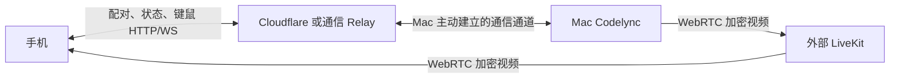

# Codelync Relay 与远程桌面部署指南

[English](SELF-HOSTING.md) · [部署模板](../deploy/self-host/) · [通信 Relay 模板](../deploy/network-relay/)

本指南对应当前源码。源码仓库 https://github.com/mapix/Codelync 已公开，
可直接阅读预览页或克隆仓库。

## 先选择需要部署的服务

**Mac 已经内置 LiveKit。选用“本机”时，Codelync 按需在 Mac 启动它，
手机连接桌面后才开始捕获画面。** 外部 LiveKit 是可选部署方案。

| 场景 | 部署什么 | Mac 配置 |
| --- | --- | --- |
| 手机和 Mac 在可互通的局域网 | 无需额外媒体服务器 | 媒体 Relay → 本机 |
| 只希望用固定自有地址替代 Cloudflare 通信入口 | Codelync Network Relay | 连接方式 → 配置 Relay |
| 手机在外网，Mac 的媒体端口不可达 | 外部 LiveKit；通信可继续走 Cloudflare 或已有 Relay | 媒体 Relay → 自定义服务器 |
| 通信和视频都通过自建公网服务 | Network Relay + 外部 LiveKit | 分别配置两处服务器 |

“通信入口可连接”和“桌面视频可连接”是两项条件。当前通信 Relay 转发
HTTP/WebSocket，内置 LiveKit 的 WebRTC 视频走独立 TCP/UDP 连接。内置服务器
使用动态媒体端口和本地网络候选地址，没有开放固定公网媒体端口或配置外部
TURN 的产品入口。**仅部署当前通信 Relay，不会把 Mac 内置 LiveKit 的视频
自动带到公网；Cloudflare Quick Tunnel 同样只承载这里的 HTTP/WebSocket。**

因此，公网媒体端口不可达时，可以使用下面的外部 LiveKit 方案。切换到
“自定义服务器”后，Mac 使用该服务器，不启动内置 LiveKit。若希望继续使用
内置服务器来覆盖这种公网场景，需要进一步实现媒体入口、ICE/TURN 配置与验证，
不应通过修改 Codelync 自动生成的临时配置文件来部署。

## 网络结构



房间和短期令牌由 Mac 创建，视频加密密钥通过已配对的密封通道送到手机。
手机不填写 API secret，也不在 VPS 登录原桌面应用。Mac 必须保持 Codelync
运行、已解锁，并有屏幕录制权限；键鼠控制另外需要辅助功能权限。

## 部署前准备

- 一台有公网 IPv4、可开放所需端口的 Linux VPS，安装 Docker Engine、Docker
  Compose 和 Node 24。当前开发基线是 Node 24.15.0；可使用兼容的 Node 24
  安全补丁。部署脚本无需安装整个工作区的 pnpm 依赖。
- 为所需服务分别准备域名。示例为 `relay.example.com`、`media.example.com`，
  使用 TURN 时另备 `turn.example.com`。部署时必须替换为自己的真实域名。
- DNS A 记录直接指向 VPS。Cloudflare DNS 使用“仅 DNS”；不要将媒体域名
  放在普通橙云 HTTP 代理后。没有配置 IPv6 时，移除指向不可用地址的 AAAA 记录。
- 本模板使用 Linux host 网络，已有 Nginx/Caddy 占用 80/443 时，需整合到
  现有反向代理，而不是同时启动第二个监听相同端口的代理。
- 模板只运行一个通信 Relay 实例。单实例 LiveKit 不需要 Redis；多节点媒体
  集群需要另外设计，这不是本模板的部署方式。

### 云安全组和系统防火墙

| 端口 | 需要的服务 | 用途 |
| --- | --- | --- |
| TCP 80、443 | 所有模板 | 自动申请证书、HTTPS/WSS |
| TCP 7881 | 外部 LiveKit | WebRTC TCP 回退，直接到媒体节点 |
| UDP 7882 | 外部 LiveKit | WebRTC UDP；模板使用单端口复用 |
| UDP 3478 | 可选 TURN | TURN UDP |
| TCP 5349 | 可选 TURN | TURN/TLS |

7880 和 8081 仅监听回环，由 Caddy 转发，不需要公网开放。只部署通信 Relay 时
无需开放媒体端口。UDP 7882 与 TCP 7881 不经过 HTTP 反向代理。防火墙还需允许
服务器正常访问 DNS、ACME 和公网地址探测服务。先保留自己的 SSH 管理通道。

## 运行模板

在 VPS 上克隆公开源码：

```sh
git clone https://github.com/mapix/Codelync.git
cd Codelync/deploy/self-host
cp .env.example .env
```

编辑 `.env`：只填写实际要启动的服务域名，未使用的域名留空。脚本会强制校验
`.env` 键名白名单（仅允许普通文件、禁止控制字符），并拒绝 `.local` 与
`example.com` 等保留示例域名；`node check.mjs` 通过 HTTPS 与有界响应读取执行校验。

### A. 仅通信 Relay

```dotenv
MEDIA_DOMAIN=
RELAY_DOMAIN=你的通信服务域名
```

### B. 仅外部 LiveKit

```dotenv
MEDIA_DOMAIN=你的媒体服务域名
RELAY_DOMAIN=
```

### C. 两种服务一起部署

两个域名都填写。`TURN_DOMAIN` 初次跑通时可留空。

生成配置：

```sh
node configure.mjs
```

脚本会生成两套独立随机密钥，写入权限为 600 的 `.env` 和 `livekit.yaml`，
同时生成 `Caddyfile`。重复运行会保留已有密钥，按 `.env` 重新生成配置；
调整域名或 TURN 时编辑 `.env`，不要直接修改生成文件。所有生成配置和证书
均被 Git 忽略。`livekit.yaml` 使用 LiveKit 可读取的 JSON 格式，避免手工
拼接密钥的 YAML 转义问题。

选择对应启动命令：

```sh
# A：仅通信 Relay，不启动外部 LiveKit
docker compose --profile network up -d --build

# B：仅外部 LiveKit
docker compose --profile media up -d

# C：两种服务
docker compose --profile network --profile media up -d --build
```

Compose profile 不会仅凭 `.env` 域名自动开启，请按选择的服务使用命令。
模板使用 LiveKit `v1.13.11`，与当前 Mac 内置服务器版本一致；Caddy 为
`2.10.2`，通信 Relay 默认保留现有 Node `24.22.2` 生产补丁版本。
Caddy 自动申请公开受信任的 TLS 证书，并支持 WebSocket 升级。

```sh
docker compose ps
docker compose logs --tail=100 caddy
docker compose logs --tail=100 livekit   # 启用了媒体服务时
docker compose logs --tail=100 network   # 启用了通信服务时
node check.mjs
```

检查脚本验证配置中各服务的 HTTPS：媒体端用短期签名令牌验证 RoomService，
通信端检查协议声明和健康端点。它不输出密钥、房间名或参与者信息。
**检查通过不代表 UDP/TCP 媒体、TURN、认证 WebSocket 注册或真实手机桌面已通过。**
`docker compose config` 会展开通信密钥，仅在自己的终端检查，不要提交或分享输出。

## Mac 产品页面填写什么

### 通信 Relay

在 **连接方式 → 配置 Relay** 填写：

| 字段 | 内容 |
| --- | --- |
| Relay 服务地址 | `https://你的通信服务域名` |
| 访问密钥 | `.env` 的 `REGISTRATION_TOKEN` |

点击 **验证并保存 Relay**。Mac 会验证服务协议、认证注册及实际 HTTP/WebSocket
通道后保存。填写服务器根地址，不要手工加 `/r/...`；每台 Mac 的认证路由由
系统分配。配置成功后启用 Relay 复选框，可与其他通信入口一起使用。

### 外部 LiveKit

在 **远程桌面 → 媒体 Relay → 自定义服务器** 填写：

| 字段 | 内容 |
| --- | --- |
| LiveKit 服务地址 | `wss://你的媒体服务域名` |
| API Key | `.env` 的 `LIVEKIT_API_KEY` |
| API Secret | `.env` 的 `LIVEKIT_API_SECRET` |

点击 **保存媒体 Relay**，开启远程桌面，并授予屏幕录制和辅助功能权限。
当前外部地址字段接受 `wss://` 或 `https://`，不接受明文 `ws://` 或 `http://`。
保存主要验证格式；连接服务器和创建房间发生在手机连接桌面时。
更换媒体配置会结束当前桌面连接，需要重新连接。

手机仍使用现有二维码配对与独立远程桌面页面，不填写服务器、访问密钥或
API secret。已配对手机可通过可用旧通道获得新的认证通信地址；所有旧通道
都不可用时，重新扫描当前二维码。

## 可选：启用 LiveKit 内置 TURN

先让基础媒体连接跑通。若实际网络需要 TURN，在 `.env` 设置独立的
`TURN_DOMAIN`，DNS 指向同一 VPS。准备该域名的受信任 TLS 证书：

```text
deploy/self-host/certs/fullchain.pem
deploy/self-host/certs/privkey.pem
```

`fullchain.pem` 包含完整证书链，证书域名必须匹配 `TURN_DOMAIN`；私钥必须匹配。
使用自己的证书管理器申请与续期，将文件内容复制或原子更新到这个目录；
不要放指向容器外证书目录的符号链接。保护私钥，确保容器可以读取。
Caddy 自动管理的 HTTPS 证书不会自动变成这些 TURN 证书文件。

```sh
chmod 700 certs
chmod 600 certs/privkey.pem
node configure.mjs
docker compose --profile media up -d --force-recreate livekit
```

开放 UDP 3478 和 TCP 5349。LiveKit 会在加入房间时向客户端提供 TURN 配置，
手机无需手填 TURN 用户名或密码。证书续期后重启 LiveKit，使它读取新证书；
这会中断当前桌面连接。

**TURN/TLS 5349 不能覆盖只允许 TCP 443 的网络。** 这类网络需要 TURN/TLS 443，
而模板的 443 已由 HTTPS 占用。使用独立公网 IP，或设计能路由 HTTPS 与 TURN/TLS
的四层 TLS 入口。普通 Caddy/Nginx HTTP 反向代理不能转发原始 TURN/TLS。
此模板不提供未经验证的 443 复用配置，也不支持给 Mac 内置 LiveKit 注入 TURN。

## 验证与排查

1. 确认对应容器运行、证书有效、`node check.mjs` 通过。
2. 若部署通信 Relay，完成 Mac **验证并保存 Relay**；这一步才验证实际
   注册和 HTTP/WebSocket 通道。
3. 手机关闭 Wi-Fi，用蜂窝网络，Mac 保持在另一网络。打开远程桌面，确认
   真实画面、键鼠、拖动、滚动和中文输入。仅在同一局域网测试不能证明公网可用。
4. 前后台切换、主动断开再连接，确认恢复后输入不会重放。再验证关闭远程桌面
   或撤销手机权限会停止捕获和控制。
5. 若使用 TURN，分别验证所需受限网络。服务器日志出现 TURN 监听不代表该次
   手机连接实际使用了 TURN；需要连接统计或受控网络测试证明路径。

| 现象 | 优先检查 |
| --- | --- |
| Mac 通信 Relay 保存失败 | HTTPS/证书、根地址、独立访问密钥、WebSocket 转发、单实例 |
| 媒体配置能保存，连接时失败 | `node check.mjs`、API Key/Secret、域名和容器状态 |
| 信令已连接但没有画面 | 屏幕录制权限、UDP 7882/TCP 7881、LiveKit 发布的公网 IP、TURN |
| 有画面但无法操作 | Mac 辅助功能权限、锁屏状态、当前画面是否已确认 |
| 只在局域网可用 | 是否仍选“本机”、媒体端口可达性、受限网络的 TURN/TLS |
| Caddy 证书申请失败 | DNS/AAAA、80/443 到达性、端口冲突、ACME 限额 |

`use_external_ip: true` 通过 STUN 探测公网 IP。探测地址错误或 VPS 不支持回环
验证时，应按 LiveKit 部署文档调整 `rtc.node_ip`/公网地址验证选项；这属于
服务器网络配置，不能靠普通 Relay 的“可用”状态证明媒体地址正确。

## 维护、密钥与现有部署模板

- 密钥与证书只保存在服务器及 Mac 私有配置。安全备份 `.env`、证书与 Caddy
  数据卷，不发布配置、日志中的凭据、手机登记信息或私人验收截图。
- 通信密钥轮换会要求所有连接 Mac 更新访问密钥并重新验证；更换 LiveKit
  密钥要同步更新 Mac 媒体设置并重新连接。重跑配置脚本本身不会轮换密钥。
- 升级前记录所用版本或镜像 digest，先在测试环境验证。更新运行中的容器会
  中断通信或媒体连接。常用停止命令为 `docker compose down`；不要添加 `-v`，
  除非明确要删除 Caddy 证书数据卷。单独关闭服务可用 `docker compose stop network`
  或 `docker compose stop livekit`。
- 已有 Kubernetes 方案见 [通信 Relay README](../deploy/network-relay/README.md)。
  该模板需已有 nginx Ingress/cert-manager、注册密钥和可用镜像，保留单副本。
  它没有部署 LiveKit，也没有因此让 Mac 的本地媒体端口公网可达。

### 验证记录的边界

当前项目有本地原生加密视频和模拟器的验证记录。外部 LiveKit、公网 NAT/TURN
及具体手机网络的结果应按实际部署另行记录；本文与模板本身不宣称这些场景
已完成验收。产品合同见 [远程桌面](../spec/codelync-remote-desktop.md) 和
[通信 Relay](../spec/codelync-network-relay.md)。
