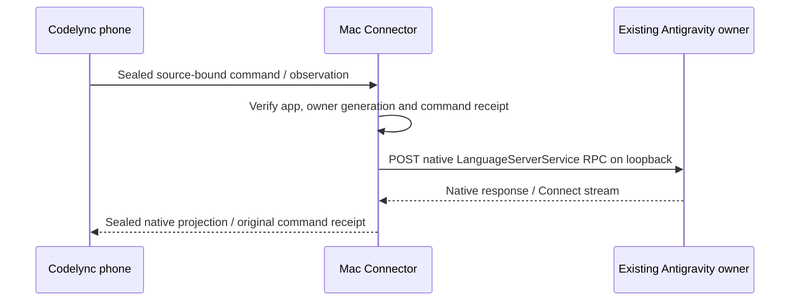

# Antigravity native remote-control wire

Investigated 2026-11-13 against Antigravity Desktop 2.31.2, macOS arm64.
This extends the [integration contract](antigravity-remote-control.md).

## Codelync path

The shipped remote-control V2 transport wraps native HTTP RPCs. It is possible
to use the same native conversation service on the existing owner's loopback
listener, with Codelync owning the remote channel, pairing, device authorization
and sealed traffic. This is **native remote-control RPC interoperability**. It
does not imply that Codelync has implemented Google's WebChannel relay, WebRTC
mesh, companion site or account service.

No native RPC listener is exposed over LAN or the public tunnel. The connector
retains the local native CSRF credential; it is never sent to the phone. A
selected original Antigravity app owner remains distinct from the isolated probe
owner, even when both contain the same conversation ID.

## Native HTTP behavior recovered from V2

- `newProxiedHTTPRequest` normalizes `rpcPath` with a leading slash and calls
  `net/http.NewRequestWithContext` with method `POST` and the supplied body.
- `payloadText` becomes UTF-8 bytes; `payload` is already bytes. These are a
  protobuf oneof and must not both be set.
- The request's supplied headers are copied into the native HTTP request.
- The wrapper adds `X-Jetski-Via-Remote-Control: true` and identifies its transport
  with `X-Jetski-Remote-Control-Transport: webchannel` or `datachannel`.
- Without an explicit content type, `x-is-streaming: true` chooses
  `application/connect+proto`; the unary branch chooses `application/json`.
  `Connect-Protocol-Version` defaults to `1`.
- `executeRequest` invokes the supplied native `net/http.Handler` through its
  `ServeHTTP` interface slot. It does not create a substitute language server or
  model runner. Response framing retains native status, headers and body bytes.
- Stream cancellation uses `x-cancel-request` to cancel an active request;
  connection/request cancellation is distinct from `CancelCascadeInvocation`,
  which stops a model invocation.

These are derived control-flow observations, not runtime proof of Google's relay.

## Vendor V2 relay envelope

The following field numbers are recovered from the current executable's embedded
`devtools/jetski/boq/api/proto/api.proto` FileDescriptorProto. Proto JSON uses the
camelCase names below. `requestId` is int64 and therefore uses a decimal string in
standard proto JSON; it is a relay correlation ID, not Codelync's durable UUID.

| Message | Fields |
| --- | --- |
| `InstanceMetadata` | `name` string (1), `version` string (2), `supportsChunking` bool (3) |
| `ConnectInstanceRequestV2` | `metadata` (1), `instanceId` string (3), `proxyResponse` (4), `supportsPayloadText` bool (5) |
| `ConnectInstanceResponseV2` | `instanceUuid` string (1), `proxyRequest` (3) |
| `ProxyRequestV2` | `requestId` int64 (1), `rpcPath` string (2), `payload` bytes (3) / `payloadText` string (5), `headers` map<string,string> (4), `isFinal` bool (6) |
| `ProxyResponseV2` | `requestId` int64 (1), `payload` bytes (2) / `payloadText` string (6), `statusCode` int32 (3), `headers` map<string,string> (4), `isFinal` bool (5) |

`ConnectInstanceV2` is bidirectional streaming. Its initial connection carries
instance metadata and identity; subsequent messages carry response frames. The
server can send instance identity and proxy requests on the other direction.
`isFinal` delimits chunked request/response bodies. A custom WebChannel service
must additionally implement the outer WebChannel HTTP negotiation and framing;
accepting this JSON envelope alone is not a complete vendor relay.

The shipped relay API also has `ProxyCommand`, `StreamProxyCommand`,
`ForwardProxyCommand`, `ForwardStreamProxyCommand`, `ListInstances`,
`UpdateInstance`, `DeleteInstance`, mesh signaling and authorized-device methods.
There is no separately named `RegisterInstance` method in this recovered service;
instance registration belongs to the connection flow.

## Native session schema

Use `/exa.language_server_pb.LanguageServerService/<Method>` for the verified
native service. Do not invent payload fields from UI labels.

- `GetAllCascadeTrajectoriesResponse.trajectorySummaries` maps native conversation
  IDs to `exa.jetski_cortex_pb.CascadeTrajectorySummary`.
- `GetCascadeTrajectoryRequest` has `cascadeId`, legacy `verbosity`,
  `trajectoryVerbosity` and `disableRehydration`.
- `GetCascadeTrajectoryResponse.trajectory` is `gemini_coder.Trajectory`, whose
  `steps` are `gemini_coder.Step`. The response also has native `status` and total
  step/generator/executor counts.
- `GetCascadeTrajectoryStepsRequest` has `cascadeId`, `stepOffset`, the same
  verbosity fields and `disableRehydration`; its response has `steps`. It has no
  count or end field. Verified 2.31.2 reads return the suffix beginning at that
  absolute step offset. The native summary supplies `stepCount`, `trajectoryId`
  and run status; selected metadata can independently confirm the total.
- `SendUserCascadeMessageRequest` has `cascadeId`, `items` of
  `TextOrScopeItem`, `cascadeConfig`, `remoteControlDetails` and `clientMessageId`,
  among other explicitly declared fields. A native user row's exact
  `clientMessageId` is usable admission correlation; text equality is not.
- The reactive stream request has `protocolVersion`, `id`, `subscriberId`.
  Responses have uint64 `version` and `MessageDiff diff`; a reactive diff is not a
  full trajectory snapshot and must be applied using the corresponding schema.
- `ClientTrajectoryVerbosity` values: unspecified 0, debug 1, prod UI 2, full 3.

Projection keeps recognized user/assistant/tool fields and their native order.
Unrecognized step variants cannot be guessed into approvals or commands. An
unsupported permission or question shape remains unavailable until verified.

Swarm generic steps reuse existing visible native content. `generic.result`
contains `result` and `stepRenderInfo`; visible Markdown content blocks (or the
legacy Markdown field) become the tool's existing output, with the original
result string as fallback. `generic.args` supplies bounded string-map input when
the native tool-call JSON is absent. No output URI, payload, internal metadata or
model reasoning is fetched or rendered. Up to 128 Markdown blocks and the existing
1 MiB visible-text/input bound apply.

An unhidden `systemMessage.agentMessage.content` becomes visible assistant text,
using an explicit `renderDetails.messageTitle` only when supplied by the owner.
The source sender ID is evidence, not a guessed display name. Both
`hideFromUser:true` and `renderInfo.hidden:true` keep the message hidden; generic
steps with `stepRenderInfo.hidden:true` remain hidden too. This projection reuses
the selected native suffix, absolute step IDs, turn identities, status and owner
generation. It does not read other agents' histories or generate a summary.

## Durable history discovery

`SearchConversations` is an additional native index, not a replacement for
`GetAllCascadeTrajectories`. Its request has `query`, `limit`, and only an
`archivedOnly` filter. There is no server cursor or offset. Empty-query unfiltered
and archived-only searches are fetched separately, with a bounded prefix, then merged
by exact native conversation ID under the stable storage namespace. These are
overlapping indices; their counts must not be added as disjoint populations.

New indexed IDs obtain their workspace and parent identities from the native
`GetConversationMetadata` response, which has `metadata`, `numSteps` and
`trajectoryId`; this does not load conversation steps. Metadata enrichment has a
bounded per-refresh budget and shares a cache within the same namespace. Native
status still comes from the resident summary and remains unknown for a history
entry absent from that status source. Search snippets and `needsAttention` are
not activity or pending-operation evidence.

`indexStale`, `diskFull`, a saturated prefix, or unconfirmed metadata cannot be
used to remove saved catalogue entries. Valid newly observed entries can still
be offered while inventory completeness is marked unavailable. Local paging is
bound to a catalogue stamp and rejects a cursor from another catalogue revision.
No claim is made that either native index contains every legacy file on disk;
unvalidated filenames never become session support.

## Security boundary and custom endpoint

The user selected Codelync's security scheme. The connector can therefore use
native loopback RPC without the vendor companion authentication path.

The vendor V2 `resolveAuth` function logs TokenSource/quota lookup failures and
returns nil/empty values. `authTransport.RoundTrip` conditionally adds a Bearer
header when TokenSource exists; nil skips that branch and still calls the
underlying transport. Thus nil Gateway OAuth is not, by itself, a native transport
barrier for a custom receiver. This does not prove any official server accepts
the request. A real custom relay connection still requires runtime verification.

## Evidence and scope

See [research and evidence](../docs/research/antigravity-remote-protocol.md).
The current shipped binary was only read. Live read-only checks used the copied,
isolated existing desktop owner. No vendor remote-control connection or model
task was executed by the protocol investigation.

## Local Jetbox summary stream authority — 2026-11-16

Each Antigravity Backend owns at most one `JetboxSubscribeToSummaries` stream.
It uses the original local LanguageServerService listener with the Connect JSON
request `{}`. Cloud backends 2 and 3 are not requested. The stream is bound to
its original process generation and storage host identity before dispatch and
publication. It reads summary headers only, never conversation histories or
mutation methods.

Connect messages use one flag byte and a four-byte big-endian length. Only plain
JSON data (flag 0) and end-stream JSON (flag 2) are accepted. Reject compression,
unknown flags, invalid UTF-8/JSON, unsafe object keys, oversized frames, headers,
IDs and malformed field types. The decoder copies incoming bytes a bounded
number of times and never repeatedly concatenates a growing pending frame.

The shipped `CascadeTrajectorySummary` descriptor defines `not_fully_idle` (21),
`has_running_subagents` (30) and `has_active_children` (18) as boolean fields and
`background_task_count` (29) as uint32. The original UI applies each `updates[id]`
as a complete replacement and applies `deletes` after updates. Only a validated
stream replacement may materialize these protobuf default false/zero values;
the legacy GetAll index cannot provide the same idle proof. A missing/invalid
status remains unknown. Keep native parent/root metadata and header capture time.

A current, connected stream epoch provides authority for every row received in
that epoch even without a new header event. Do not expire rows by last-event
recency, synthesize newer capture times or re-open a stream to renew them. Return
scoped `liveProof` and per-ID ready/deleted/unknown states. `complete` describes
coverage of requested IDs, not completeness of the full source inventory.

Disconnect, end-stream, malformed data, owner mismatch or disposal immediately
withdraw authority. Reconnecting to the same owner creates a new stream epoch;
no old row becomes ready until the new epoch supplies it again. First-header
waits and owner validation are shared, bounded and abortable; replica reads are
synchronous and never open a stream. Incremental listeners report availability,
epoch/revision and affected IDs so status can change without text changing.
Disposal cancels the reader, native request and reconnect timer. Retain original
owner/app operation IDs and never replay a mutation through this observer.
