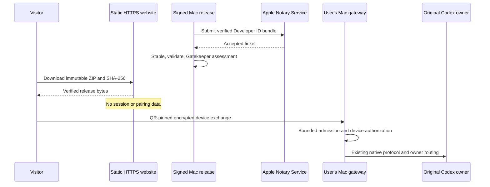

# Public source, Mac distribution and website

## Owners and scope

The user authorized public source at `https://github.com/mapix/CodeLight.git`
and a landing page with a notarized Mac download on the existing novarocks
Kubernetes cluster. The website is a static distribution surface: it must not
host pairing, session relays, account keys, private conversations or phone
development provisioning artifacts. Existing Codex, Antigravity and Claude
Desktop owners remain untouched.

Publish a reviewed initial source snapshot without private development history.
Preserve the original local history. Include an MIT license, accurate upstream
notices, contribution/build/security guidance and reproducible release inputs.
Exclude upstream Google service configuration, credentials, local registries,
extracted applications, private QA and device-bound iPhone packages. Scan source
and the initial public Git history; checksum/test-vector exceptions must be
specific and explained. Dependency findings require remediation or a documented
reachability assessment, not a blanket claim that a scanner proves safety.

Public source, deployment examples and the final software archive must not contain
the publisher's saved private Relay server URL or hostname. Deployment examples
use `relay.example.com`; the installed app reads each user's saved configuration
outside its bundle. Compare the actual private configuration against selected
source files, reachable public Git history and every expanded release member,
including binaries. Keep matching values and audit captures private; public
reports contain counts and paths only. This check supplements secret scanning,
since a hostname may not match a credential detector.

The public source archive selects existing tracked and nonignored files only
inside the current standalone workspace's explicit source/configuration roots.
Deleted tracked files are omitted without reviving them. Refuse symlinks rather
than silently following external paths; exclude private state, network identity
and access-key files, generated dependencies/builds and obsolete prototype specs.
The v2 `connection-channels.json` file contains the saved Relay key and is
excluded by Git ignore, source selection and archive verification, just like
the legacy network access/identity files. A public source test must exercise
this filename with a private sentinel, not assume all JSON is publishable.
Use the same selection when creating the clean initial public Git snapshot.

`docs/tasks/` contains private implementation diaries and device acceptance
notes. Keep these files in the original workspace, outside both source archives
and canonical publication checkouts. Current product contracts belong in `spec/`;
only curated, privacy-reviewed documentation is included in public source.

Source ZIPs contain the selected regular file bytes only. Omit resource forks,
extended attributes, quarantine data and AppleDouble/`__MACOSX` sidecars, which
are outside the source manifest and may contain publisher-specific metadata.
Check raw ZIP members before extracting. This rule is specific to source exports;
the signed Mac application archive retains its separate notarization rules.

## CI publication

The current GitHub publisher lacks the OAuth `workflow` scope. Publish the
reviewed CI configuration as `docs/ci/verify.yml`, without activating GitHub
Actions or requesting broader credentials. A repository owner can move it into
`.github/workflows/` when they choose to enable CI. Local release gates still run.

## Security release changes

Apply supported security fixes to bridge/relay dependencies and compatible
transitive patches. Development-only findings must be distinguished from code
in the shipped Mac bundle. Keep the native SDK line and original owner protocol.
The CodeLight mobile configuration is the default; upstream analytics, services
and OTA publishers must not activate on an ordinary source checkout.

The public gateway must bound connection count, request/header time and expensive
unauthenticated pairing admission. Invalid or exhausted pairing requests do not
call credential issuance. Authorized sync, revocation and original command
admission retain their owners. Lost credential exchange acknowledgments retain
the same key-bound response. Unknown cumulative traffic after storage failure
must remain unmeasured instead of displaying a invented zero.

Keep Expo 55 and its legacy image-size API compatible. Patch container-header
parsing so malformed ICNS entries cannot retain the same offset, and BMFF/JXL
zero-sized boxes consume the remaining input instead of looping. Validate
minimum headers and complete bounds. Run malformed inputs in bounded child
processes and retain valid image dimensions. Record patched package versions
honestly when advisory tools still match the old version number.

## Website and platform truth

Use the existing CodeLight brand and layout with compact Chinese and English
copy. The primary action downloads only the currently verified public Mac
release; its displayed version, bytes and SHA-256 come from that release's
accepted, stapled and Gatekeeper-checked metadata. The integrated candidate is
Mac 0.7.1/build 2026111701, paired with iPhone 1.9.1/build 2026111701. Publish its
Mac download only after the current candidate's Apple Accepted result,
stapling, Gatekeeper, artifact privacy and recorded phone acceptance gates.
Until then retain the verified 0.6.1 metadata and download. Keep prior immutable
0.5.8 and 0.6.1 downloads and checksums after the new release is published.
The iPhone source build remains distinct from the public Mac download.

The integrated candidate makes the three Desktop sources individually optional,
selected by default on first setup, with durable choices on Mac. Disabling a
source releases CodeLight's own observation; it does not close the original app.
Remote desktop is a separate optional page and defaults to disabled. Describe
its confirmed display selection, quality/frame rate, landscape, fullscreen and
Spaces controls without claiming physical multi-display or arbitrary public
NAT/TURN acceptance. A website introducing unreleased candidate features must
identify the required candidate version while retaining the verified download.

The current product supports Codex, Antigravity Desktop and Claude Desktop
(Gateway). State this three-Desktop scope consistently in the website, README
and Mac headline/scope localization. Available operations depend on the original
desktop's current state and confirmed native capabilities; support for an app
does not mean every operation is identical across apps. Project/session browsing, available child logs,
bounded incremental reading and local tool-group expansion do not imply that
every app/mode has working input, stop, approval, model or effort controls.
Claude Desktop Gateway's complete formal controls remain unaccepted and must
not be described as complete support. CLI families and historical window
adapters remain deferred and are not promoted. State macOS 14+ on Apple Silicon,
preview status, and that the iPhone app currently needs source building rather
than a public App Store/TestFlight release or device-bound IPA. Explain
trusted-device access and temporary tunnel renewal.
Explain both public-access providers: Cloudflare Quick Tunnel addresses can
renew on restart; an authenticated Relay preserves its independent route across
reconnections. Phone setup remains the same QR flow, with no provider settings.
Performance numbers must identify host benchmarks; do not promise cool phones.
Use no analytics, external fonts or third-party scripts. Respect keyboard focus,
reduced motion and narrow phone layouts.

Recovery copy follows [error and recovery rules](codelight-error-recovery.md).
Explain a Mac connection failure separately from an original Desktop app being
offline. Users can open CodeLight on Mac, check their network, retry or choose a
saved connection; when the original app is unavailable they can open that app
and retry while saved messages remain readable. Unconfirmed actions offer
Check result and must not be submitted automatically again. Use familiar words
such as connection, original app, messages and result; do not expose internal
protocol names, URLs, private paths or raw exceptions. Loading/retry behavior
must not be described as successful live acceptance without current evidence.

Attachment copy says that content loads only after a click. A readable video is
limited to 1,000,000 plaintext bytes (1 MB); an oversized video stays blocked.
Metadata or a card's presence does not establish readable native-file access.
The website must not promise playback/save for every native attachment or
publish private phone packages, profiles, keys or QA fixtures.

The existing publication route is `codelight.novarock.io` through the dedicated
`codelight/codelight-website` Kubernetes deployment. Copy-only updates use a
fresh immutable image, preserve the current verified release metadata and all
existing versioned download bytes, and leave ingress, TLS, service and other
workloads intact. Record selected page hashes and deployment inputs before
publication; validate the deployment change server-side and verify rollout,
HTTPS language/FAQ controls, narrow layouts and the retained download metadata.
The HTML script reference carries a content-derived revision so an existing
browser cache cannot pair new Chinese HTML with an older English dictionary.
Verify ordinary page loading as well as explicit uncached resource hashes.

The existing GitHub repository currently requires access permission and keeps
its current visibility. Link to it as the source repository, not as publicly
accessible source. Source-build instructions state the access requirement; MIT
license text does not imply that every visitor can clone the repository. A public
Mac download does not change source-repository visibility.

## Mobile experience candidate — 2026-11-17

The 0.7.1/1.9.1 candidate at build 2026111701 implements the
[mobile remote desktop experience](codelight-remote-desktop-mobile-experience.md)
contract. It removes the remote page's bottom navigation, preserves a single
video canvas under translucent controls, and provides an accessible focused
keyboard with explicit input acknowledgment and draft preservation. Prepare,
sign, install and record acceptance for this candidate separately from the
prior 1608 trial and its notarized private archive.

## Prior integrated candidate — 2026-11-17

The 0.7.0/1.9.0 candidate at build 2026111608 uses a complete native iOS Release
build with the pinned desktop media SDKs and helpers. It does not reuse an older
native phone base with only a replacement JavaScript bundle. Source review,
Mac build/signing, device installation and native interaction acceptance remain
separate evidence. The user performs this candidate's physical-phone acceptance;
do not replace that record with a health endpoint or pairing bootstrap result.

Native helper builds must use portable source/debug path provenance. Remove
publisher-specific compiler paths through supported compiler prefix mapping or
debug stripping before signing; do not patch arbitrary binary strings. Preserve
SDK resource lookup, licenses, pinned dependencies and executable behavior. The
public Mac artifact requires a fresh hash-bound privacy review after these
packaging changes, without replacing the installed trial app or restarting any
original Desktop owner.

## Historical release preparation — 2026-11-16

The next candidate uses Mac 0.6.1, iPhone 1.8.1 and the shared build
`2026111603`. Build 1601 remains a prior private phone install; build 1602
remains the QA/SIM descendant-activity candidate. The 1603 candidate adds the
necessary child read-entry and unavailable-layout recovery corrections.
Record that build in source metadata and allow an explicit
`CODELIGHT_MAC_BUILD` override for the Mac builder; validate the numeric build
before packaging. Device and simulator packages consume one frozen Hermes
bundle and preserve the verified native iOS base, existing signing/profile,
application identity and framework bytes. Marketing/build metadata changes do
not enable additional native controls or change the saved Gateway setup.

Freeze and build App runtime inputs only after the mobile/backend freeze,
Root's joint tests and runtime privacy checks pass. Source-only archive flags,
specification and website edits may finish separately; they do not invalidate
the App runtime freeze. Record their final overall source manifest after the
strict archive/privacy gate completes. Before each
installation capture fresh current data, rather than restoring an older draft
or receipt baseline. Preserve all keys, pairing/configuration, drafts and prior
operation IDs. Restart only CodeLight's owned service when required; original
Codex, Antigravity and Claude Desktop sessions, queries, drafts and Gateway stay
untouched. Native error/recovery observations remain separate from component
tests and health checks. Public Mac 0.6.1 replaces the legacy 0.5.8 download only
after actual Apple Accepted, stapling validation, strict signature/Gatekeeper,
archive/privacy checks and the external version/size/SHA-256 download gate pass.

Generated Prisma clients in the Mac runtime must not retain the publisher's
absolute generation paths. Normalize only `config.generator.output.value` and
`config.generator.sourceFilePath` to portable provenance (`.` and
`schema.prisma`). Preserve the generated schema/data model, engine type,
relative schema locator, inline schema hash and `config.dirname` behavior.
Validate the normalized metadata and exercise the packaged client/database in
an isolated directory before signing; no production database or native desktop
session is used by that check.

## Distribution gates

1. Secret/privacy review, source/production dependency audit and scoped regressions.
2. Bridge/mobile/production relay typechecks and root Lint.
3. Fresh Mac build, expected Developer ID chain and secure timestamp verification.
4. Apple Accepted result, stapled ticket validation, Gatekeeper acceptance.
5. Repacked archive integrity, published SHA-256 and reviewed release metadata.
6. Public source/license check and successful HTTPS page/download checks.
7. Kubernetes deployment in a dedicated namespace with a nonroot, read-only
   static container, dropped capabilities, no service-account token, bounded
   resources, readiness/liveness probes and network policy. Do not change other
   workloads. Validate server-side manifests before applying and verify rollout,
   certificate and external downloads afterwards.
