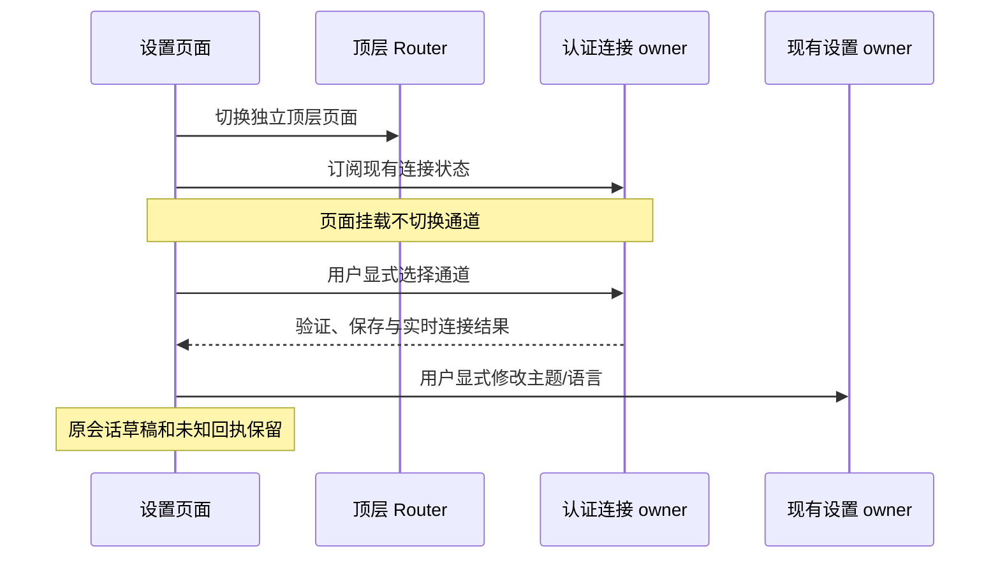

# Codelync 手机顶层导航与全局设置

## 页面规则

- 手机顶层包含「会话」(`/`) 与「设置」(`/settings`) 两个独立页面；已配对的顶层页面显示统一底部导航。
- 顶层切换使用现有 Router 导航，返回会话页复用原页面，保留搜索、项目展开和列表位置。重复选择当前页不重载、不发起连接或原会话操作。
- 会话列表只承担项目/会话浏览、搜索与同步反馈。完整连接选择、语言和扫码配对位于全局设置；聊天页移除输入区附近的网络按钮，仅在 header 放一个当前连接图标，点击后复用同一切换表单。
- 设置按「连接」「显示」「关于」组织。连接包含当前通道选择与扫码配对；显示包含主题与语言；关于显示 Codelync 版本。
- 连接选择仍由 `codelyncConnection` 唯一拥有；设置页订阅真实状态、复用现有选择表单，不另存连接或 peer 状态，也不在页面挂载时自动切换。
- 主题与语言复用现有设置所有者。主题实时应用到原生外观、键盘、页面与底色；语言继续走现有语言页及其保存/重启流程。
- 顶层导航和设置页面不向原 Codex 发出导航、输入或控制请求，不清除草稿、未确认操作或会话缓存。
- 会话列表离开前台时暂停其可见项目状态读取；设置页不为显示连接状态加载任何聊天历史。
- 进入会话后先排队新鲜读取并展示“正在同步”。缓存中的断连/不可用状态不构成本次失败；只有当前读取或当前选择确认失败后才显示错误和 Retry。重试立即回到同步状态，旧请求的结果不能覆盖新请求。
- 目录标题刷新不阻止浏览或点击已有会话。已配对手机启动时先恢复当前账户绑定的加密目录缓存，并立即开放列表；缓存不能确认原会话活跃状态。启动、前台重连与 Retry 在异步目录请求之前排队新的同步 generation，清除上次错误的显示资格。连接正在恢复或目录尚未新鲜确认时显示标题同步；只有当前连接上的当前目录读取失败才显示可重试错误。单个会话的最新读取独立于全目录标题同步。
- 保存地址在 Mac 暂停/启动后失效时，冷启动 `connect_error` 与断连都触发现有自动选路所有者；选路进行中不重复启动。Socket.IO 每次重试先进入 connecting，并生成新的单次设备证明，复用其现有重试/backoff，不新增 native mutation 重发。会话正文在连接恢复期间显示同步；连接恢复为 ready 之前，Sync 为可见会话与目录先排队新 generation，再启动新鲜读取，旧失败不能短暂回到错误界面。
- 正文加载条与 source banner 遵守相同连接恢复规则。桌面选择的 authority 在 peer 模式下绑定当前认证 Mac 身份，不能因同一 peer 更换地址误报失败；不同 peer 仍拒绝，legacy 连接保留原 endpoint 隔离。

## 布局与视觉

- 沿用现有主题：页面 `#F2F2F7`、卡片 `#FFFFFF`、正文 `#000000`、辅助文字 `#8E8E93`、强调色 `#2BACCC`、已确认状态 `#34C759`；暗色使用对应主题 token。
- 使用 IBM Plex Sans 的标题/正文、IBM Plex Mono 的版本信息；Codelync 标识沿用现有品牌组件。页面保持单列分组，连接状态在一个完整设置行中呈现。
- 底部导航遵守垂直与横屏水平安全区（`left`/`right`/`bottom`），点击区域至少 48pt；长标签（如日语「リモートデスクトップ」）保持单行自适应缩放或尾部省略，不换行挤压相邻标签；设置页头部与滚动内容遵守横屏水平安全区，同时保留全宽底色与分隔线，支持长文案、字体放大与横屏，不叠加重复导航标题。
- 顶部导航操作（默认返回、聊天返回、会话详情入口、首页新建与横屏返回悬浮按钮）提供语义角色与本地化可访问标签，图标与边框随明暗主题保持清晰对比度；会话浮层提示锚定在悬浮 header 与安全区下方，不遮挡状态栏或玻璃标题。
- 设置中的连接行与聊天页 header 共享同源错误强调色（`textDestructive`）与扫码配对恢复入口（`onScan`）。
- 问答补救浮层（`AgentQuestionModal`）与横幅在有键盘输入时保持滚动画布、自定义回答输入区、错误提示与提交栏处于键盘上方（`KeyboardAvoidingView` + 底部安全间距），取消/忽略/提交保持 >=44pt 点击区、对称头部宽度（适配 EN/ZH/JA）、禁用态弱化反馈及明暗主题选中/边框/错误对比度；行内问答表单（`InlineQuestionForm`）同样提供清晰的单/多选边框与主色提交态、完整的 `radio`/`checkbox`/`button` 无障碍语义，且点击选项不自动提交。
- 会话浏览列表（`CodelyncSessions`）在空列表且处于有效发现加载阶段（非错误、非搜索空结果）时展示加载指示与文案；缓存已有条目或终端错误时不遮挡浏览；子代理展开按钮提供 `expanded` 状态与 >=44pt 点击区，项目标题与搜索框具备无障碍标签及溢出截断，可视窗口对比使用结构化字段比较而非 `JSON.stringify`。
- 输入栏（`AgentInput`）的权限沙盒后缀（`sandboxed`）与操作按钮/状态提示在 EN/ZH-Hans/ZH-Hant/JA 下使用显式本地化文案；权限/模型/工作量/上下文芯片与发送/停止/语音控制均提供完整的无障碍角色、标签与状态（`disabled`/`expanded`/`busy`/`selected`），并在明暗主题下保持分割线、锁定态与禁用态图标的可读对比度，不新增冗余按钮或开关。
- 会话加载条（`CodelyncSessionLoading`）、来源同步横幅（`NativeSourceBanner`）与不可用恢复页（`NativeSessionUnavailable`）的重试与返回按钮保持 >=44x44pt 点击区、完整的 `button` 语义与 `disabled`/`busy` 状态、进行中弱化透明度（`opacity`），并以一致的主题底色与细分隔线/浮层边框与正文区区分，不额外增加网络诊断或跳转按钮。
- 原生子代理与任务面板（`CodelyncSubagents`、`CodelyncNativeTasks`、`CodelyncNativeTaskActions`）的弹窗遮罩在暗色主题下提高对比不透明度（`0.56` vs 浅色 `0.28`）并保留卡片细边框，弹窗外边距与内部滚动列表提供底部安全留白；不可用或进行中的重试、日志、输出、停止及结果检查按钮保持 >=44x44pt 点击区、明确透明度弱化（`0.45`）与 `accessibilityState` 禁用/忙碌态。
- 聊天头部（`ChatHeaderView`）与原生子代理会话头（`SessionView`）：子代理主标题优先展示具体代理名称（`agentName` / `title`），将「来源应用 · 子代理」及分支信息置于副标题行，避免 EN/ZH/JA 三段式前缀在窄胶囊内把子代理名称截断；iOS 玻璃标题浮层在左右 `16pt` 内容边距基础上叠加 `titlePillInset`（与返回/右侧按钮保持完整间距），胶囊与副标题行具备 `minWidth: 0` 与单行尾部省略并遵守水平安全区（`left`/`right`）。
- 首次配对/扫描引导（`OnboardingScreen`、`CodelyncScanScreen`）：支持短屏与横屏垂直滚动并遵守水平与底部安全区留白，顶部/底部间隔随内容滚动自然收起，帮助按钮（`GetHelpButton`）最小可点击尺寸为 `44x44pt`。
- 只读模型目录弹窗（`NativeReadonlyModelCatalog`）：遮罩在暗色主题下提高对比不透明度（`0.56` vs 浅色 `0.28`）、弹窗保留细边框与垂直外边距，底部只读提示以细分隔线与列表区分，关闭与选项行保持 >=44pt 高度。
- 消息跨会话移交（`CodelyncHandoff`）与父会话接管控制（`NativeParentControl`）：移交触发与弹窗取消按钮最小可点击尺寸为 `44x44pt`，标题单行省略（`minWidth: 0`）避免与取消按钮碰撞，暗色遮罩增强不透明度并保留弹窗细边框与垂直留白；父会话不可用重试失败提示使用主题告警色（`warningCritical`），重试按钮在忙碌/禁用态下降低透明度（`0.45`）并声明 `accessibilityState`。
- 项目与会话活跃状态展示（`CodelyncProjectStatus`、`CodelyncSessionStatus`、`StatusDot`）：不以纯颜色区分状态，每个状态均配对可辨识的几何指示符号（实心圆点、方块/菱形角标、空心圆环）与本地化文字标签，状态容器合并播报 `accessibilityRole="text"` 与完整 `accessibilityLabel`；纯装饰性 `StatusDot` 在未提供无障碍标签时对读屏隐藏。
- 对话中工具/工作折叠组头部（`ToolsGroupHeader`、`AgentWorkGroupHeader`）：展开与折叠交互行最小高度保持 `44pt`（`AgentWorkGroupHeader` 头部与尾部复用同一高度以维持倒置列表几何对称），提供完整 `button` 语义、文本标签与 `expanded` 状态，主计数/耗时文案使用高对比正文色与尾部对齐箭头，次要时间戳使用次级文字色与等宽数字。
- Mac 连接状态提示条（`CodelyncConnectionNotice`）：重试与扫码入口保持 >=44pt 点击区，重试中/忙碌态对 `codelync-retry-mac-connection` 降低透明度（`0.45`）并声明 `disabled`/`busy`，顶部避让叠加 `topInset` 与会话加载/来源横幅一致，容器底部以 `hairlineWidth` 分隔线区分下方列表内容，标题与文案允许窄屏收缩折行不溢出。
- 选择弹窗与设置分组列表（`PickerSheet`、`Item`、`ItemList`）：`PickerSheet` 限制最大高度不超过窗口 `70%` 且避让顶部安全区与横屏水平安全区，内部使用 `ScrollView` 承接 Dynamic Type 放大后的滚动，标题与选项标签支持最多两行换行、暗色遮罩增强不透明度；`Item` 为左右两列设置 `minWidth: 0`、右对齐多行详情值（最多 2 行、宽度受控）及不可挤压的右侧图标；`ItemList` 遵守横屏水平安全区与底部安全留白。
- 通道选择器与二级子路由（`PeerChannelControlView`、`session/[id]/{files,file}`、`text-selection`、`settings/appearance`、`restore`）：`PeerChannelControlView` 的紧凑模式（`compact`）胶囊保留 `>=44pt` 高度、`paddingVertical` 与 `numberOfLines={2}` 换行及 `lineHeight`，两侧图标不可挤压（`flexShrink: 0`），避免在 XXXL 大字号或中/日双段路径状态（`Selected · Current`）下截断；各 `app/(app)/*` 二级路由遵循横屏左右与底部安全区（`useSafeAreaInsets`）、Dark Mode 输入框与选中态文字对比度、带输入页面的 `keyboardShouldPersistTaps="handled"`、`>=44x44pt` 头部/切换按钮热区以及完整的 `button`/`radio`/`selected`/`disabled` 无障碍语义。

## 所有者与操作顺序

## 验收场景

1. 已配对会话页只显示浏览/搜索内容，底部有会话、设置入口；设置页为独立路由，返回保留列表状态。
2. 打开设置不触发通道切换或原会话 RPC；连接行显示实际当前选择，手动/自动切换沿用现有身份和错误保留。
3. 主题可实时切换，语言页可返回设置，扫码配对仍由用户显式启动。
4. 原生模拟器检查浅色、深色、安全区、导航返回、连接选择表单及长文案；真机安装后确认实际布局与原会话继续可用。
5. 聊天输入区没有网络选择按钮；header 的网络图标保留可访问名称、44pt 点击区域和当前连接状态，点击打开现有选择表单，不挤压标题或替换会话信息入口。
