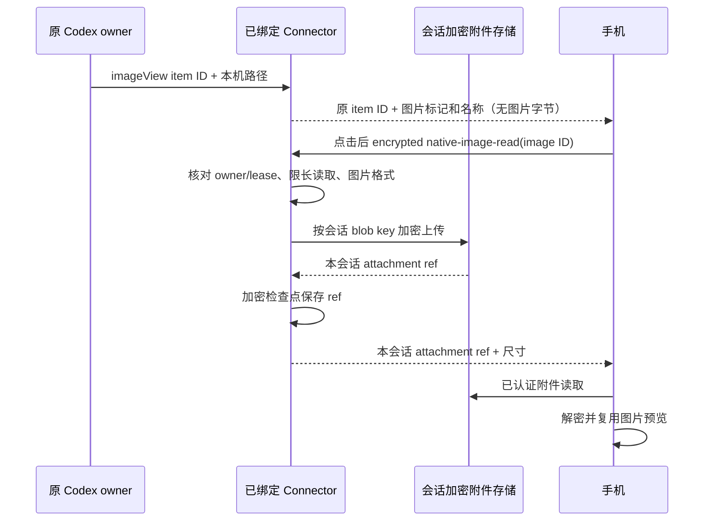
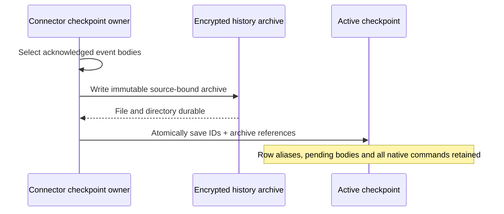
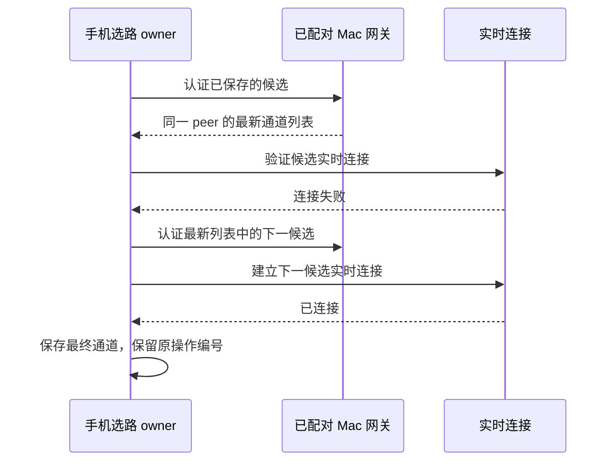
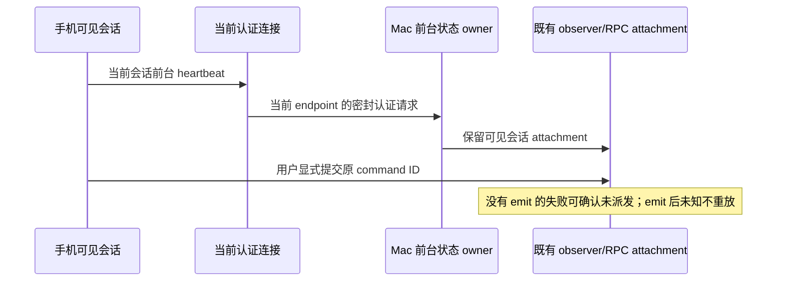
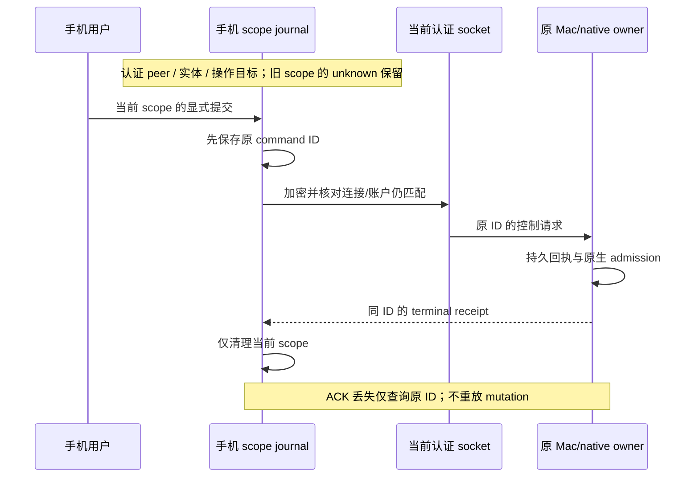
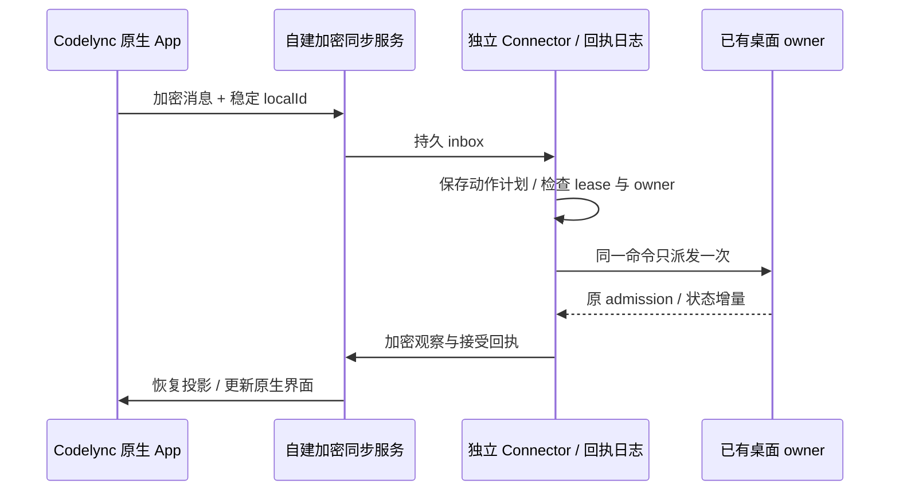

# Codelync 产品与验收合同

## 新产品命名与首次发行

当前产品名、源码命名空间、App 标识、配对协议和本地存储统一为 Codelync。
首次 Codelync 发行使用 Mac/iPhone 1.0.0、构建号 2026111705，官网为
`https://codelync.novarock.io/`，源码为 `https://github.com/mapix/Codelync`。
iPhone bundle ID 与 Android `applicationId` 均为 `com.learnings.codelync`
（Mac 为 `com.learnings.codelync.mac`）。用户明确不要求旧 CodeLight 标识兼容或数据迁移；
旧应用及数据备份仅作为历史资料保留，不进入新安装和公开包。原 Desktop 会话
与运行时仍由原应用持有，不因产品更名修改或重启它们。

早期 CodeLight 手机端与加密同步服务基于 Happy 的 MIT 许可源码。
当前 Codelync 保留相关版权、许可和继承说明；后续原生 Desktop 接入与控制
不将第三方 Desktop 软件打包分发。

## Android 正式版与无推送功能对齐 — 2026-11-18

Codelync Android 客户端（`applicationId` 为 `com.learnings.codelync`，主入口
`com.learnings.codelync/.MainActivity`，URI scheme 为 `codelync://`，整数
`versionCode` 与当前移动构建号对齐）面向日常使用与正式安装包交付，同时支持本地开发
构建（Debug APK，`assembleDebug`）与内嵌 Hermes 字节码、静态资源和原生动态库、可脱离
Metro 独立安装冷启动的签名正式包（Release APK，`APP_ENV=production ./gradlew assembleRelease`）。
Android 自适应桌面图标（foreground/monochrome）与明暗启动页统一使用 Codelync 品牌资产，
不保留上游历史 `"H"` 图标；本地签名密钥与 keystore 严格保留在未追踪路径，不进入仓库或公开包。

Android 版本除推送通知能力外与现有 iPhone 版本全面对齐：

- **支持范围与原桌面所有者一致**：仅连接并呈现已启用桌面来源（`Codex`、`Antigravity Desktop`
  与 `Claude Desktop (Gateway)`）的原生项目、会话、子代理、原生后台任务与原应用已确认可用的
  控制操作；独立 CLI/TUI 家族、其他 harness 与窗口/AX 控制继续延期，不发现、不激活、不在界面宣传。
- **跨平台扫码、配对深链与局域网直连 HTTP**：应用内扫码统一使用 `expo-camera` `CameraView`
  （iOS `AVFoundation`、Android `CameraX`/`Camera2`）读取 QR，相机权限被拒绝时提供直达系统应用设置
  （`Linking.openSettings()`）与粘贴配对链接回退（`codelync://pair?...`），扫码弹窗响应 Android
  系统返回关闭。Android 注册 `codelync://pair` 的 `VIEW`/`BROWSABLE`/`DEFAULT` intent filter
  （正式构建同时声明 `https://codelync.novarock.io` App Links）以支持冷启动与前台唤起配对。
  鉴于 Mac 局域网通道绑定私有 IPv4 明文传输层（`http://<mac-lan-ip>:<port>` 与 `ws://<mac-lan-ip>:<port>`，
  全负载仍由 Codelync X25519 box / secretbox / Peer Codec v3 端到端加密且每请求强制携带
  `Authorization: Codelync <packet>` 密封设备证明），Android Debug 与 Release APK 均允许本地网络明文
  HTTP 通信（`usesCleartextTraffic: true`）；公网 `cloudflare` 与 `relay` 通道继续强制 HTTPS/WSS 证书校验。
- **无权限系统选图与加密附件上传对齐**：Android 图片选择直接调用系统 Photo Picker
  （`PickVisualMedia` / `PickMultipleVisualMedia`），不声明 `READ_EXTERNAL_STORAGE`、
  `WRITE_EXTERNAL_STORAGE`、`READ_MEDIA_IMAGES` 或 `READ_MEDIA_VIDEO`，且在 Android 上跳过
  `requestMediaLibraryPermissionsAsync()` 以避免 Android 12 及以下因禁用旧存储权限被误拒。
  选图与剪贴板粘贴图片与 iPhone 执行同一归一化与校验规则：单条消息最多 `20` 张图片，按长边不超过
  `3072` 像素等比缩放并转为 JPEG（质量 `0.92`），通过文件系统实测转换后字节数（防止缺失或 `0`
  `fileSize` 绕过上限），并在加密前按 `MAX_FILE_SIZE - 40`（`10,485,720` 明文字节，预留 40 字节
  secretbox nonce + MAC 开销以符合 `10 MiB` 密文上限）完成校验与上传。
- **无推送（Push-Free）运行模式与前台会话租约**：Android 本期不包含远程推送能力。Android 清单移除并禁止
  `android.permission.POST_NOTIFICATIONS`；客户端在启动、配对完成与回到前台时直接短路推送注册
  （返回 `status: 'unsupported'`），不弹出系统通知权限框、不获取设备推送 token、不调用仅接受 APNs
  十六进制 token 的 `POST /codelync/notifications/device`，也不产生错误提示、日志告警、无效设置项或同步阻塞。
  Mac 设备列表中该设备 `notifications` 为 `false`，“测试通知”自动禁用，在线状态与撤销不受影响。
  与此同时，Android 前台活跃期间每 `15` 秒及切换会话焦点时照常发送密封的
  `POST /codelync/notifications/presence`（`{ active, sessionId, sequence }`），维持 `DeviceRegistry.viewedSessions()`
  的 `<= 45` 秒可见会话租约，与 iPhone 一致地保护当前查看会话的原生观察器不被后台回收或 LRU 淘汰。
- **Android 全面屏安全区、软键盘避让与系统返回**：关键页面与透明系统栏弹窗遵循边到边安全区与输入法避让、非 Compose
  尺寸塌缩规避及单层优先的硬件返回键／边缘返回手势规则，详见 [移动端导航合同](codelync-mobile-navigation.md) 与
  [远程桌面移动端体验合同](codelync-remote-desktop-mobile-experience.md)。

## 当前发行定位 — 2026-11-17

App、TestFlight、GitHub Release 与官网面向已在原桌面应用配置模型 Gateway
的用户。介绍范围限定为 Codex、Antigravity Desktop 与 Claude Desktop
（Gateway）的已有原生会话；日常官方订阅使用推荐各厂商的官方 App。
这项发行定位不改变下面记录的底层协议事实，也不将未核验的原生操作变成支持能力。

手机远程桌面是可选功能，首次和升级默认不显示入口，用户在 Settings 的功能
开关中主动启用后才显示。该开关不替代 Mac 的远控启用、屏幕录制或辅助功能授权。

iPhone TestFlight 发行使用 production APNs 签名。iOS 设备的已验证注册声明对应的 APNs
环境；Mac 发送器按设备环境投递至 Apple 的 sandbox 或 production，保留原有
开发设备；Android 客户端运行于无推送模式，不注册推送 token。密钥和设备 token
保留在设备及个人 Mac，不进入公开源码或发行包。

手机二维码配对（“扫描二维码” / “扫描 Mac 二维码”）在 iPhone 与 Android 上统一使用应用内
`expo-camera` `CameraView` 相机扫码视图（iOS `AVFoundation`、Android `CameraX`/`Camera2`
QR 元数据输出）、配对深链唤起与粘贴链接回退（`codelync://pair?...`），
通过即时相机权限检查（被拒绝时提供直达系统“设置”的引导）并在首次引导与
Settings 中明确提示权限或配对错误，不被后台自动恢复阻塞。

## 独立远程桌面 — 2026-11-16

用户授权新增独立于所有原生会话的远程桌面功能。Mac 默认关闭，媒体 Relay
默认由本机拥有，可配置外部 LiveKit 服务；手机以独立顶层页面连接已配对的
Mac，支持分别调整清晰度与流畅度。远控使用原生屏幕采集和系统输入，不创建
Agent 会话，不把屏幕或点击当作原生会话身份或业务 admission。既有窗口来源
适配器及其他 harness 继续延期。实现与验收以
[远程桌面合同](codelync-remote-desktop.md) 为准。

## 当前支持范围 — 2026-11-17

当前产品支持 Codex、Antigravity Desktop 和 Claude Desktop（Gateway）的原生
会话。目录、来源标签、设置、构建说明与官网统一列出这三种 Desktop；各来源
仅显示原应用当前已确认可用的模型、slash command、子代理和控制操作。
Claude Desktop 的完整正式控制仍需通过其验收门槛。所有独立 CLI/TUI 家族
继续延期。以下较早日期的接入章节保留各来源的协议与验收边界，不缩小当前范围。

Mac 的加密 machine metadata 也声明这三种 `sourceApps`；该支持范围标记不
代替原应用的实时目录、当前可用性或具体控制能力。独立 runner availability
继续为 false，不能因 Desktop 支持而启用相应 CLI。

Mac 可独立选择接入 Codex、Antigravity Desktop 和 Claude Desktop（Gateway），
默认三项全选，选择会保存。关闭来源只停止 Codelync 对该来源的发现、观察与控制，
原桌面应用和会话继续由原 owner 执行。空选择、失败恢复及旧操作保留边界见
[来源接入选择](codelync-source-subscriptions.md)。

### 模型 Gateway 与原生会话接入

这里的 Gateway 指原桌面模型请求所用的第三方推理网关，与 Codelync 的配对、
Relay 和网络通道不同。三种 Desktop 的接入条件如下：

| 桌面 | Gateway 要求 | 原生接入条件 |
| --- | --- | --- |
| Codex | 不要求 Gateway；Gateway 与非 Gateway 模式均不构成接入模式限制 | 已运行的 Desktop IPC owner、原会话身份和协议校验 |
| Antigravity Desktop | 不要求 Gateway；模型 Gateway 与会话接入独立 | 已运行的原生 LanguageServerService owner、原会话身份和协议校验 |
| Claude Desktop | 当前仅接受已核验的 Gateway 模式；普通官方登录／非 Gateway 模式尚未支持 | 显式安装并核验的原生 owner bridge／runtime manifest，且当前有效 Gateway 配置通过校验 |

这不代表三种 Desktop 的全部操作都已通过验收。各来源按原 owner 当前已确认的
能力提供操作；Claude 的正式安装与完整功能验收门槛仍然有效。

## Claude Desktop Gateway — 商业打磨范围，2026-11-14

用户已将范围扩展为 Codex、Antigravity 与 Gateway 模式 Claude Desktop，
所有 CLI/TUI 家族延期。Claude 仅接受显式安装并核验的原生 owner manifest，
按 Code/Chat 原生 collection 隔离来源；未配置或未核验的模式不进入目录。
既有 Gateway 配置与当前 Desktop 运行时保持所属关系；独立 CLI/SDK runner、
官方 OAuth/Remote Control、窗口截图不能替代原生会话接入。
Claude 正式应用安装与完整模式验收仍为发布门槛，隔离副本的成功不得表示正式
支持已完成。详见 [Claude 原生合同](claude-desktop-native.md) 与
[商业验收合同](codelync-commercial-quality.md)。

项目会话 badge 与 active/waiting/unknown/total 使用同一普通会话范围。
明确 `isSubagent:true` 的来源不占项目会话状态观察预算，也不计入未知会话数；
普通 fork 的 parentId 不足以判定子代理。父会话内的原生子代理列表与聚合状态
继续独立呈现，不能因此把缺失或不完整的子代理状态当成零。

## Codex 与 Antigravity 原生会话 — 2026-11-13

用户已授权将产品范围扩展为 Codex 与 Antigravity Desktop。Codex 保留既有
desktop IPC owner；Antigravity 复用远控实际代理的原生 LanguageServerService
RPC，由 Codelync 提供远端配对、密封传输和设备授权。其他历史 harness、
CLI runner、窗口共享和 AX 控制仍延期。接入与验收规则见
[Antigravity 远控合同](antigravity-remote-control.md)。只有通过原 owner、
会话身份和明确协议校验的来源才进入当前产品。下文 Codex 的已有能力与
验收保持有效；不代表 Antigravity 自动具备每一种 Codex 专属操作。

Codelync 的原生应用标识 `com.learnings.codelync` 始终启用原生项目／会话
目录和有限会话加载。启动时 Expo manifest 尚未可用或旧配置缺字段，不能
回退到历史 Happy 的顶层会话列表或全量历史同步。配置缓存不能更改产品范围。

## Codex imageView projection — 2026-11-02

- 点击后的 Mac 图片处理生成去除元数据的 JPEG 预览，必要时降低画质及尺寸，最终加密附件不超过 500,000 字节。源文件保留，正文同步仍只传占位标记；未点击时不解码、不压缩、不上传。输出缓存按压缩策略版本隔离，不能复用旧的原图 ref。
- 图片加载失败的原生诊断只记录阶段、耗时和固定错误码，不记录原图片、路径、URL、密钥、用户文字或附件 ref。分别核对原图片读取、RPC 解密、响应校验、附件下载、blob 解密与原生渲染。
- 预览加载成功后提供“下载图片”按钮，使用当前已解密的图片打开手机系统保存菜单，支持相册/文件保存，不再重新下载原图。临时图片位于 App 缓存，保存菜单关闭后清理；保存失败提示可重试，不影响查看和关闭。
- Mac 打包须包含已安装的图像库平台原生模块及动态库。仅导出二进制、未导出 package.json/默认入口的生产依赖也必须可定位，不能因 exports 限制而被误判为未安装的 optional dependency。安装前用签名包内 Node 实际加载并压缩图片；图片库延迟到点击时加载，避免影响连接服务启动。
- 私有 USB 诊断可将本机当前入口作为已配对手机的候选定位地址。手机须用原配对密钥认证 Mac 返回的通道列表，确认相同 peer 后交给既有自动选路所有者验证实时连接并保存；不创建新配对、账户或会话，不依据地址本身信任对端。
- 图片 RPC 和下载读取当前连接 owner 已保存的配对凭据与通道清单，不能用 Sync 初始化时的旧通道快照向新入口发送无认证请求。同一 peer/账户/设备的通道变化可继续只读加载；其他 peer、账户或设备变化必须拒绝，旧式连接保留地址/token 隔离。
- 将本机附件 URL 改写为当前入口时，协议、hostname 和 port 必须分别完整替换；HTTPS 默认端口须清掉本机端口，保留 Relay 路径前缀。外部存储 URL 保持原值。

- 原 owner 的 `imageView` 是可见工具消息，必须保留原 item/turn ID 和顺序，不能因没有文本而跳过。
- 仅对原生记录明确给出的本机图片路径读取附件，不接受手机传入路径，不新增文件浏览或手机上传能力。源图片限常规 PNG/JPEG/GIF/WebP、64 MiB 与 6400 万像素；压缩后的加密附件限 500,000 字节。
- 同步只传图片标记、原 item ID 和文件名。最近页、实时流与后台刷新不读取图片文件、不上传图片、不下载缩略图；正文显示可点击占位图。
- 点击占位图后才经当前会话加密 `native-image-read` RPC 传原 image ID。Connector 根据该 source 的原生记录定位路径，复用当前会话的加密 blob key 和 ACL 发布不可变副本，ref 先在加密检查点落盘再返回。重复点击、ACK 丢失和重启复用同一 ref，不按文件名或文字去重。
- 手机只在预览打开后额外读取附件。图片加载期间显示进度，失败保留占位与可重试提示；不能让单张图片失败使整个会话同步失败。预览复用现有缩放、平移、关闭组件。原 owner/lease 改变时拒绝本次读取。
- 图片投影语义迁移必须刷新已有 Connector 的快照版本；原 owner 正文未变化也要替换旧图片参数，不能被内容 stamp 或手机去重压住。原 item ID 与已保存附件 ref 保留。
- 验收覆盖：同步/挂载占位图时图片读取与上传为零、点击后首次加载、重复点击/ACK 丢失/重启不重复上传、历史图片、缺失/超限/非图片文件、任意路径和不同 source/会话请求拒绝、最近页与实时消息的占位参数、真机点击报告会话中的图片。

## Control responsiveness and observation budget — 2026-11-01

- A large legacy Codex observer checkpoint moves already-acknowledged event
  bodies and prefixes outside the current observation window into immutable
  encrypted history archives before the 32 MiB active checkpoint limit is
  reached. Stable event IDs, row aliases/revisions, current prefixes, command
  plans and receipts remain in the active checkpoint. An archived prefix that
  re-enters the current window is authenticated and restored before applying
  native revisions. Pending event bodies and
  unknown native operations are never discarded or redispatched.
- Archive files are made durable before their references replace acknowledged
  bodies in the active checkpoint. A restart can reuse the same authenticated
  archive after an interrupted migration. Archive failure leaves the original
  active bodies intact. Historical audit/recovery can validate source/key
  identity and reconstruct every archived event.

- IPC framing copies each received byte a bounded number of times; large native
  snapshots cannot require quadratic buffer accumulation. Frame limits, version,
  target, owner and lease validation are retained.
- An existing matching live subscription may route requests directly to its
  original ownerClientId, as the native follower does. Absent/stale subscriptions
  still use owner discovery; this never bypasses native canHandle/version checks.
- Empty bootstrap and identical metadata/state updates do not rewrite encrypted
  journals or issue new CAS updates. Real native content changes and admission
  receipts remain durable.
- When push is unavailable (including push-free Android clients and unsigned
  simulator builds), remembered history entries are not all restored as
  full observers. Selected/viewed sources and unfinished work remain protected;
  unviewed quiescent observers can retire while history and receipts remain.
  Lightweight project activity remains separate from full message observation.
- Unknown asynchronous-question replies can be confirmed only by an accepted
  original user row carrying that exact command ID under the same owner/epoch.
  A different device's answer or a pending/rejected steering row is insufficient.

2026-10-31 的 Codex 专用定位已由上述 2026-11-13 授权扩展。既有延期研究
源码保留，Antigravity 必须通过新原生协议接入，不能恢复旧窗口适配器。

## 产品规则与所有者

- 自动选路先以已配对密钥认证通道列表。HTTP 可读不等于实时通道已连接；首个候选实时连接失败时，继续验证同一 Mac 返回的最新候选，包括重启后变化的 LAN 地址。新地址须逐个认证并建立实时连接后才能显示 connected。手动选择只验证指定候选，失败保持原选择。候选替换不改变 peer、会话、凭据密钥或待确认操作编号。

- Codelync 基于本地 Happy MIT fork 的真实原生会话、工具、Markdown、附件与主题组件。App 名、原生 bundle、链接 scheme、启动页与设置统一为 Codelync，保留许可证归属。
- 桌面 Connector 是观察者和转发者，Codex 原 owner 仍拥有原会话、运行时与 admission。Connector 不创建、恢复或重启原 Agent，不修改原应用源码、包、配置。窗口 ID、截图或 AX 控件不能冒充 Codex session ID 或原生会话协议。
- Mac App 内置加密同步服务、Connector 和出站隧道。本地独立数据目录保存配对密钥、加密检查点和操作摘要；手机凭据由原生安全存储拥有。
- 配对后 Mac App 默认显示实时及累计网关流量、HTTP/RPC 交互、在线设备和运行时长；通过“统计／扫码配对”切换内容。二维码续期保留当前选择，隐藏时不重新生成图片。详见 [Mac 统计页合同](codelync-mac-dashboard.md)。
- 正常首次使用只需打开 Mac App 并在手机扫描其二维码，不要求服务器选择、注册、匿名账号创建或 VPN。短期公网地址变化后重新扫描；公网使用 HTTPS，不能悄悄访问 Happy 公共服务。高级自建服务/诊断入口不改变正常扫码流程。
- 手机输入只有原 owner admission 才显示接受。断线、服务重启、未知回执保持稳定命令编号，不自动重发已经派发的动作。
- v2 peer 连接下，session/machine/model control RPC 的持久记录与 in-flight 合并按认证 peer、实体 ID 和操作/问题目标隔离；同一 Mac 的通道切换保留该身份。没有 peer 的旧连接继续使用原地址隔离，旧入口或其他会话的未知记录保持独立。结果未知的同目标操作只查原编号回执，不自动换编号重发。
- 旧版全局或地址 scope 记录只在原地址与实体匹配时尝试只读回执恢复；原回执可辨认目标时，不匹配的旧目标不能进入新问题的 scope。未确认结果和缺少身份依据的旧记录不被猜测为成功，也不自动重放。加密期间发生连接/账户切换时，请求不能发到新 socket。验收包含旧入口另一会话、同实体不同问题目标、同 scope ACK 丢失恢复、通道切换、旧记录保留与加密期间换连接。
- 手机提交后的传输错误或缺失终态回执只能标为“结果待确认”，不能标为已拒绝。先以原 commandId 只读查询回执；完成则结束提交，仍未知则保留原答案与身份，用户只能检查结果或关闭表单，不能用新 ID 重发。关闭待确认表单不发送取消操作。离线 socket 不缓存变更请求；重连和重新进入会话可只读恢复当前实体的未确认操作。私有诊断只记录操作阶段、时间与状态，不记录答案、凭据或地址。
- 原生集成发现：descriptor 尚未激活时 HTTP ACK 只代表进入中继。UI 和 Sync 双层要求普通 session 已 connected、非空 runtimeGeneration、steering=true 才能提交；所有非侵入手机 user 记录（包括缺 expectsAcceptance 的旧记录）hold 至 native accepted/rejected/unknown，明确排除原观察历史。Source activation banner 使用父 header 真实 top inset，不能被 glass header 遮挡，失败须可见。
- 实际 Native async question 只有 communications form、没有可关联内联 AskUserQuestion 卡时，即使有 choices 也必须展示 fallback banner/modal。只在明确存在可渲染且同 toolUseId/id 的内联卡时排除，不能按“有选项”假设内联卡必然存在。保留原 form question IDs、options 与 free-text，用户显式 Submit 后发送原 communication/question identity，点击选项不自动提交。
- 当前待回答的 fallback 提示独立于手机浮动输入区的状态淡出。用户阅读较早历史时，新问题仍必须可见、可打开；不能因为 `isChatAtBottom=false` 而同时隐藏提示并禁止触控。其他状态区、滚动按钮、输入草稿及原 question 所有者不变。验收包含在较早历史位置收到新 communication、打开表单并选择、显式提交一次、原 owner 回答/退役后移除提示；开发预览 `/dev/agent-question?history=1` 用于核对滚动历史时的固定提示和原生表单。
- 非 prefix 文本修订按 sourceRowId/revision 替换原片段，工具中途输出保持 running；只在原工具终态后显示完成。
- 原 native steering 输入的临时 item ID、`pending-user:callerId` 与接受后的正式行 ID 必须按原 caller/server 关联收口。源投影携带明确的替换行身份和历史 wire 别名；完整快照先到时也能移除旧临时显示行。不能按文字相同合并不同用户输入，替换别名的退役独立于正文版本去重。
- 手机底部只催当前轮未回答的问题；旧轮问题保留真实历史答复证据，不重新进入待操作队列。过期回复在 native dispatch 前拒绝，详见 [Codex 原生 IPC 合同](codex-native-ipc.md)。
- 项目视图在手机前台显示来自原 Codex 状态的轻量活跃/待操作统计，每条可见会话显示活跃、待操作、空闲或未确认状态。最近更新时间不是运行状态；未确认、过期或断连的数据不能显示为已确认的零。状态同步与当前会话的历史同步分开，详见 [项目状态合同](codelync-project-activity.md)。
- 原生项目内会话通过一行选择框切换，沿用已有项目归属、会话身份和路由。打开选择框不加载所有历史、不向原 Agent 发命令；重复选择当前会话保留输入草稿。
- 用户界面说明和翻译统一列出 Codex、Antigravity Desktop 和 Claude Desktop（Gateway），并按各来源的实际能力提供操作。保留的 CLI、其他 harness 或窗口研究代码不进入当前支持清单。

## RPC scope 与事件顺序

- 手机前台会话状态（`POST /codelync/notifications/presence`，`<= 45` 秒租约）独立于推送权限与平台推送能力，在 iPhone 与无推送 Android 客户端上一致运行。v2 peer 必须通过当前认证连接发送密封请求；同一 Mac 换通道后使用当前 endpoint 与最新 peer 凭据，不能继续向旧地址发送普通 Bearer。
- 当前可见会话的前台状态保护既有 observer/RPC attachment；离开前台才允许其按现有空闲规则回收。连接或 peer 改变时，旧状态不能发送到另一个 Mac。
- RPC broker 在没有目标、参数无效或试图自调用且尚未 emit 时返回明确的 `effectMayHaveOccurred:false`。手机只将这种已确认未派发的新操作视为可重试；emit 后的断线/超时仍保留原编号并只读查询。旧版本留下的未知记录不因新规则自动重发或删除。

## 构建边界

本产品是用户明确要求开发并在本地模拟器／设备测试的独立 fork，Codelync 本地编译与测试针对当前源码（覆盖 Mac App、iOS 构建以及 Android 本地 Debug APK 与可独立安装的签名 Release APK）。上游 Happy 的 EAS/OTA/商店发布流程属于上游产品发布；本轮不运行这些流程。独立产品输出需有对应的源码版本、构建标识、校验和及验证报告。

## 验收

完整网络验收包含当前 Mac App 的内置同步服务、局域网与出站通道、Connector 和原生手机 App（iPhone 与 Android）。原桌面应用须由原 owner 持有会话；发现和观察只绑定既有原 owner，绝不新建同会话 writer。类型/单测、模拟器、真机安装、网络可达与温度/帧率分别记录，不能互相代替。

1. 打开独立 Mac App，手机（通过应用内相机扫码、`codelync://pair?...` 深链唤起或粘贴配对链接，含局域网直连场景）完成端到端加密配对，连接已启用桌面来源原 owner 并同步项目与原生会话。
2. 原生界面显示 Codelync、历史和工具；原输入、停止、模型/推理强度确认更新、问题/权限回应只作用于所见原会话身份。常规 UI、状态和恢复验收不向用户私人会话发送新模型测试输入。
3. 字符增长、非 prefix 修订、工具输出、重复消息、Connector 重启和 App 重启正确恢复，不重复 native dispatch；Android 无推送模式下前台在线租约与实时消息同步正常，无推送报错、权限弹窗或阻塞。
4. 手机系统选图与粘贴图片归一化加密上传，以及会话内图片/受限视频/文件点击打开、缩放、平移、保存与关闭；附件只经源绑定加密链路提供，错误可见且可重试读取。
5. 前台项目状态、会话选择框、可选独立远程桌面（画面解密与触控/键盘输入）和语言/主题切换通过对应回归与原生验收；Android 模拟器正式安装包（Release APK，停止 Metro 独立冷启动）通过引导/配对页、项目与会话列表页、会话详情输入页、远程桌面页、设置页的状态栏、全面屏手势栏/三键导航栏、软键盘避让与系统返回手势/返回键核验，无遮挡、白屏或闪退；历史多 harness/window spec 不计入当前支持清单。
6. 提供可重建的源码、启动命令、本地模拟器/独立安装包（含 Android Release APK）与当前验证报告，准确列出尚未验证的平台或能力。

